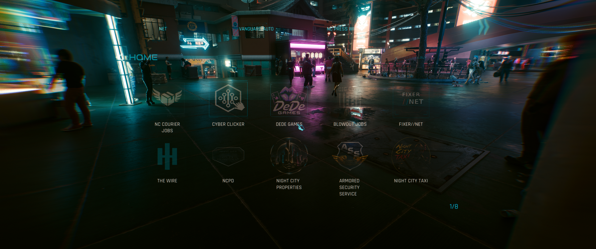

# Kiroshi NetLink

Opens an in-game computer screen straight in the player's Kiroshi optics in Cyberpunk 2077: one key, and the screen floats in view on foot and in cars, with an optional screen dimmer. Single-player only.
Version 1.7.1 | For game version 2.5 | Status: 1.1.0 and 1.3.0 used in game on 2.31; 1.7.0 failed its in-game test on 2.5; 1.7.1 in use in my game and working; no written test record

> This is an unofficial fan work and is not approved/endorsed by CD PROJEKT RED. No game files are included.



*The NetLink home screen with the sites installed on the test setup.*

**This repository is source, not a ready-to-install package.** It cannot be installed from this repository alone, for two reasons:

1. The mod needs its own `.archive` file with the floating screen entity. That file is a binary built from another author's entity and a game mesh, so it is not included here. The script that built it is (see Install).
2. `netlink_dim.reds` imports DigitalVixen Core without a guard, so the scripts compile only with that mod installed.

## The problem

Reading mail, the NET or a shop page in the game means walking to a computer, or using a tablet mod that plays an animation and puts something in the player's hands. The idea here: the player character's Kiroshi optics already show overlays, so the same screen should open in view on one key, wherever the player is, without stopping.

## What I built

A Cyber Engine Tweaks script (1,057 lines of Lua) and two small redscript files (77 lines). On one key, the script spawns a stripped-down copy of the game's own computer device just in front of the player's eyes and switches to the game's own device view, the same path used at any computer in the world. The screen follows the player on foot and in a car until it is closed. It changes: it adds a temporary computer device in front of the player while the screen is open, and with the dimmer on it darkens the whole picture.

## How it works

- **The device.** The archive holds `netlink_screen.ent`: the game's computer device reduced to its screen quad and its zoom camera, with the world interaction prompt switched off and a see-through screen material, so the opacity slider can show the world through it.
- **Open.** The script spawns that entity at the active camera (through Codeware's dynamic entity system), sets the device camera's field of view to the player's and the screen distance from the chosen panel width, then asks the device to zoom in, as a quest would. Closing uses the game's own exit or the same key again. The entity is deleted only after the camera has blended back, never while the device camera is active.
- **Near plane.** The device camera does not draw anything closer than about 0.105 m. The screen never comes closer than 0.115 m; where a wide field of view (in cars) would need it closer, the device camera's field of view is narrowed instead, so the panel keeps its share of the view.
- **Follow (1.7.1).** The device is bound to the player's body root inside the engine (`netlink_bind.reds` wraps the engine call; the script can also call it directly). Its camera is then lined up against the player's real view: the rendered camera is measured relative to the player or the car before the zoom, the device camera the same way after it, and the difference is taken out through local transforms. If the binding does not hold, the device falls back to being moved every frame, as in 1.6.1.
- **Refused** where the game camera is not the player's: cinematic scenes, braindance, the autodrive cinematic camera, while dead, while controlling a camera or turret, or while already using another device. Getting in or out of a vehicle or switching the vehicle camera closes the screen.
- **Dimmer.** `netlink_dim.reds` adds one dark grading layer to DigitalVixen Core's colour grading service. The script turns it on and off and sets the darkness. It also works when the screen is closed.

```text
package/
  bin/x64/plugins/cyber_engine_tweaks/mods/CyberslopKiroshiNetLink/init.lua   the window, hotkeys, open / follow / close
  r6/scripts/CyberslopKiroshiNetLink/netlink_bind.reds                         engine binding helpers
  r6/scripts/CyberslopKiroshiNetLink/netlink_dim.reds                          screen dimmer layer
  (archive/pc/mod/CyberslopKiroshiNetLink.archive is not here: see Install)
tests/mock.lua       runs init.lua against a small physical model of the game (76 checks)
tools/build_ent.py   builds netlink_screen.ent / .mesh and packs the archive
```

## Requirements

| Requirement | Version | Link |
|---|---|---|
| Cyberpunk 2077 | 2.5 | |
| Cyber Engine Tweaks | a build for 2.5 | [Nexus Mods, mod 107](https://www.nexusmods.com/cyberpunk2077/mods/107) |
| redscript | a build for 2.5 | [Nexus Mods, mod 1511](https://www.nexusmods.com/cyberpunk2077/mods/1511) |
| Codeware | a build for 2.5 | [Nexus Mods, mod 7780](https://www.nexusmods.com/cyberpunk2077/mods/7780) |
| DigitalVixen Core | needed by `netlink_dim.reds` | [Nexus Mods, mod 28390](https://www.nexusmods.com/cyberpunk2077/mods/28390) |
| The mod's own archive | built with `tools/build_ent.py` | see Install |

To build the archive you also need Python 3, WolvenKit CLI 9.1.0, and the two source files described in Install. Nothing is bundled.

## Install

Not tested from this repository; these steps describe the layout the mod was developed with.

1. Install the requirements above.
2. Copy the contents of `package/` into the game folder, so that `bin\x64\plugins\cyber_engine_tweaks\mods\CyberslopKiroshiNetLink\init.lua` exists.
3. Build the archive:
   - Install WolvenKit CLI 9.1.0 so that `%LOCALAPPDATA%\Programs\WolvenKit.Console\9.1.0\WolvenKit.CLI.exe` exists (the path the script uses).
   - Serialize two files to JSON with WolvenKit and put them in `tools\source\`: `tablet_computer.ent.json`, from `tablet_computer.ent` of the mod Computer Anywhere by Deceptious, and `tablet_c_neo_military.mesh.json`, from the game's `base\environment\decoration\electronics\devices\tablet\tablet_c_neo_military.mesh`.
   - Run `python -I -X utf8 tools\build_ent.py`. It edits the entity and mesh, converts them back, checks the edits survived a round trip, and writes `src\archive\pc\mod\CyberslopKiroshiNetLink.archive` under the repository folder (the layout of the development folder; `.gitignore` keeps it out of the repository).
   - Copy that file into the game's `archive\pc\mod\`.
4. Start the game. The CET console shows `[KiroshiNetLink] Ready v1.7.1`. Bind "Open / close Kiroshi NetLink" in CET > Bindings and press it.

Without DigitalVixen Core the redscript compile fails because of `netlink_dim.reds`. The Lua script treats the dimmer as optional (it logs that the dimmer is missing), so leaving out that one file should keep the rest working without the dimmer. That has not been tested.

## Uninstall / roll back

1. Close the game. Do not remove the mod while the screen is open.
2. Delete:
   - `bin\x64\plugins\cyber_engine_tweaks\mods\CyberslopKiroshiNetLink\` (also removes `config.json`)
   - `r6\scripts\CyberslopKiroshiNetLink\`
   - `archive\pc\mod\CyberslopKiroshiNetLink.archive`
3. Saves are not affected: the device is never saved, and the dimmer state is reset on every load and pushed again from `config.json`.

## Configuration

Window "Kiroshi NetLink" in the CET overlay, saved in `config.json` next to `init.lua`:

| Option | Default | Range |
|---|---|---|
| Open NetLink / Close NetLink | | button |
| Panel width (share of view) | 0.62 | 0.30 to 1.00 |
| Opacity | 0.90 | 0.15 to 1.00 |
| Centre left / right (m) | 0.000 | -0.100 to 0.100 |
| Centre down / up (m) | 0.000 | -0.100 to 0.100 |
| Optics sounds | on | |
| Event log (CET console) | on | |
| Darken screen | off | |
| Darkness (%) | 50 | 0 to 95 |
| Unstick camera / UI | | button: releases a device camera that did not give the view back |

`config.json` also stores two values the script learns by itself (`simBias`, `simBiasN`): the measured gap between where the device camera is placed and where it renders, used to pre-align the next open while driving.

Hotkeys in CET > Bindings, both unbound by default: "Open / close Kiroshi NetLink" and "Darken screen on / off".

## Status

| Version | Game | Result |
|---|---|---|
| 1.0.0 | 2.31 | First in-game test: worked, except that "Unstick" crashed the game. |
| 1.1.0 | 2.31 | Confirmed working in game. |
| 1.2.0 | 2.31 | Background opacity slider changed nothing in game. Shelved. |
| 1.3.0 | 2.31 | Installed and used in game; the screen dimmer was kept. |
| 1.3.1, 1.3.2 | 2.31 | Keeping the screen bright under the dimmer: both failed in game. Shelved. |
| 1.4.0 | 2.31 | Preloading the device: changed nothing in game. Reverted. |
| 1.5.0 | 2.31 | Keeping one device alive between opens. No test result recorded. Reverted. |
| 1.6.0, 1.6.1 | 2.31 | Works in vehicles; a fault remained while driving. |
| 1.7.0 | 2.5 | Failed its in-game test: in a car the view came from the footwell or from behind the seat. |
| 1.7.1 | 2.5 | In use in the author's game and working (author's statement, 2026-11-24). No written test record. |

Checked for 1.7.1 before release: the redscript compile of the installed script set with the new file gave 0 errors and 6 warnings (the same 6 as before). Checked for this repository: `tests/mock.lua` passes 76 of 76 checks on the published `init.lua` with LuaJIT. The mock models a moving car, a camera reported one frame late, teleports that land one frame late and a device that rides the player's body root once bound. It covers standing, running, 108 km/h in first and third person, a bend, uneven frame times, a binding that does nothing or lands far away, a camera that ignores its local transform, leaving the car, the camera toggle, refusals, timeouts, error recovery and the dimmer.

## Compatibility

| Item | Status | Notes |
|---|---|---|
| DigitalVixen Core | required | The dimmer declares the module name of that mod's own debug grading probe, which the core reads when it exists. If that debug probe is installed too, remove one of the two (duplicate class names). |
| True Sunglasses | stacks | Uses another slot of the same grading service. |

## Known issues

- 1.7.1 has no written in-game test record. Three things could not be checked without the game before release: that the binding keeps the device in place and accepts the body root, that the camera system reports the device camera once the zoom is on, and that the device camera accepts a local transform at runtime. Each has a measured fallback, and each shows in the event log.
- The event log is on by default and writes lines to the CET console on every open.

## Engineering notes

**Problem (1.6.0).** In a vehicle, the screen showed for a moment and then disappeared, although it was still open and could be used; on closing it showed again for a moment.

**Diagnosis.** The device's zoom camera clips everything closer than about 0.105 m. The screen distance comes from the player's field of view and the panel width. The vehicle camera is wider than on foot (field of view 70 to 76 against about 59), so in every car the screen landed at 0.09 to 0.10 m. The test logs showed the same split: every open at 0.11 m or more showed the screen, every open at 0.09 to 0.10 m lost it. The brief glimpse was the player's own camera, which has a closer near plane, before the switch and after closing.

**Fix.** A minimum screen distance (0.115 m since 1.6.1). Where the panel width would need the screen closer, the device camera's field of view is narrowed instead, so the panel keeps its size in view.

**A failed fix and what it showed (1.7.0).** 1.7.0 bound the device to a camera component with the engine flag "keep world transform" off. In game the view came from the footwell or from behind the seat. The log said the device was 3,239 m away from its camera, which was the player's distance from the map origin: with the flag off, the engine keeps the old world position as an offset. The fallback then took its pose from the camera component, which in a car is the body root, not the rendered view. 1.7.1 binds with the flag on (as the game does) and lines up against the rendered view instead of trusting any single pose source.

**Rollback.** Each version was installed by a script that kept the previous files. For a user: delete the three paths under Uninstall.

## Changelog

See [CHANGELOG.md](CHANGELOG.md). Latest: 1.7.1 (2026-11-23): the device is bound to the player's body root and lined up against the rendered view.

## Credits and licence

The screen entity in the archive is derived from `tablet_computer.ent` of Computer Anywhere by Deceptious and from a game mesh; neither is included here. The dimmer runs on DigitalVixen Core by DigitalVixen and uses the same grading path as True Sunglasses. Runs on Cyber Engine Tweaks, redscript and Codeware. None of these is included here.

MIT, see [LICENSE](LICENSE). The licence covers my code only. Game names and trademarks belong to their owners.

Built with AI assistance (Claude); designed, tested and maintained by me.
